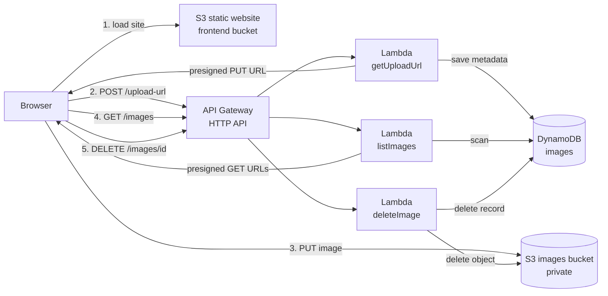

# Snapshelf: Serverless Image Upload App on AWS

A photo upload and gallery app built entirely on AWS serverless services. The frontend is a static site hosted on **Amazon S3**. Photos are uploaded **directly from the browser to a private S3 bucket** using presigned URLs, so image data never passes through Lambda or API Gateway.

**Live demo:** [https://dxq9xaxo17d4s.cloudfront.net](https://dxq9xaxo17d4s.cloudfront.net)

> Region: `ap-south-1` (Mumbai)


## Features

- Drag and drop, paste, or pick multiple images at once
- Per-file upload progress bars
- Client-side validation (JPG, PNG, WebP, GIF, max 5 MB) plus server-side content-type allow-list
- Masonry photo gallery with a full-size preview
- Delete photos with a confirmation prompt (removes the S3 object and its DynamoDB record)
- Private images bucket: photos are viewed through short-lived signed links
- Dark mode support and a responsive layout

## Architecture


The same flow as a diagram that GitHub renders from text:



## Tech stack

| Layer | Service |
|---|---|
| Frontend hosting | Amazon S3 (static website hosting) |
| API | Amazon API Gateway (HTTP API) with CORS |
| Compute | AWS Lambda (Python 3.12) |
| Metadata | Amazon DynamoDB (on-demand) |
| Image storage | Amazon S3 (private bucket) |
| Access control | AWS IAM (least-privilege role) |
| Logs | Amazon CloudWatch |
| Frontend | HTML, CSS, vanilla JavaScript |

## How it works

1. The browser asks `POST /upload-url` for permission to upload a file of a given type.
2. `getUploadUrl` validates the content type, creates a unique key, saves a record in DynamoDB, and returns a presigned **PUT** URL valid for 5 minutes.
3. The browser uploads the file straight to S3 with that URL.
4. `GET /images` triggers `listImages`, which reads the records from DynamoDB and returns presigned **GET** URLs (valid for 1 hour) so the private images can be displayed.
5. `DELETE /images/{imageId}` triggers `deleteImage`, which looks up the record, deletes the S3 object, then removes the DynamoDB record.

## Repository structure

```
snapshelf/
├── backend/
│   ├── getUploadUrl.py
│   ├── listImages.py
│   └── deleteImage.py
├── frontend/
│   └── index.html
├── docs/
│   └── screenshots/
└── README.md
```

## Setup

Use a single region (here `ap-south-1`) for every resource. Replace the example names with your own.

### 1. S3 buckets

**Frontend bucket** (`myapp-frontend-<id>`)
- Turn off "Block all public access"
- Enable static website hosting with `index.html` as the index document
- Add a bucket policy allowing public `s3:GetObject` on `arn:aws:s3:::myapp-frontend-<id>/*`

**Images bucket** (`myapp-images-<id>`)
- Keep "Block all public access" on
- Add this CORS configuration, using your website endpoint as the origin:

```json
[
  {
    "AllowedHeaders": ["*"],
    "AllowedMethods": ["PUT", "GET", "HEAD"],
    "AllowedOrigins": ["http://myapp-frontend-<id>.s3-website.ap-south-1.amazonaws.com"],
    "ExposeHeaders": ["ETag"],
    "MaxAgeSeconds": 3000
  }
]
```

### 2. DynamoDB table

- Table name: `images`
- Partition key: `imageId` (String). The name is case-sensitive.

### 3. IAM role for Lambda

Create a role `image-upload-lambda-role` with `AWSLambdaBasicExecutionRole` and this inline policy:

```json
{
  "Version": "2012-10-17",
  "Statement": [
    {
      "Effect": "Allow",
      "Action": ["s3:PutObject", "s3:GetObject", "s3:DeleteObject"],
      "Resource": "arn:aws:s3:::myapp-images-<id>/*"
    },
    {
      "Effect": "Allow",
      "Action": ["dynamodb:PutItem", "dynamodb:Scan", "dynamodb:GetItem", "dynamodb:DeleteItem"],
      "Resource": "arn:aws:dynamodb:ap-south-1:<ACCOUNT_ID>:table/images"
    }
  ]
}
```

### 4. Lambda functions

Create `getUploadUrl`, `listImages` and `deleteImage` (Python) using the role above, paste the code from `backend/`, and set these environment variables on both:

| Key | Value |
|---|---|
| `BUCKET` | `myapp-images-<id>` |
| `TABLE` | `images` |

### 5. API Gateway (HTTP API)

Routes (exactly these three):

| Method | Path | Integration |
|---|---|---|
| POST | `/upload-url` | `getUploadUrl` |
| GET | `/images` | `listImages` |
| DELETE | `/images/{imageId}` | `deleteImage` |

CORS settings:
- Allow origin: your S3 website endpoint (`http://...`, no trailing slash)
- Allow methods: `GET`, `POST`, `DELETE`, `OPTIONS`
- Allow headers: `content-type`

Do not add manual `OPTIONS` or `ANY` routes. They override API Gateway's built-in CORS handling.

### 6. Deploy the frontend

1. Edit `frontend/index.html` and set `API` to your invoke URL.
2. Upload it to the frontend bucket.
3. Open the S3 website endpoint.

### Verify the API before uploading

```bash
# Should return []
curl https://<api-id>.execute-api.ap-south-1.amazonaws.com/images

# Should return 204 with an access-control-allow-origin header
curl -i -X OPTIONS "https://<api-id>.execute-api.ap-south-1.amazonaws.com/upload-url" \
  -H "Origin: http://myapp-frontend-<id>.s3-website.ap-south-1.amazonaws.com" \
  -H "Access-Control-Request-Method: POST" \
  -H "Access-Control-Request-Headers: content-type"
```

## Problems I ran into and how I fixed them

| Problem | Cause | Fix |
|---|---|---|
| `AccessDeniedException` on DynamoDB `PutItem` | The IAM inline policy was missing or its table ARN didn't match | Rewrote the policy with the exact region, account ID and table name |
| `Missing the key imageId` | Partition key was created as `imageid` / `Imageid`, and DynamoDB keys are case-sensitive | Recreated the table with the key `imageId` |
| Browser CORS error on `/upload-url` | Wrong or unsaved allowed origin, a missing route, and resources split across two regions | Used one region, matched the origin to the exact website URL, and tested the preflight with `curl` |
| `405` when uploading to S3 | Presigned URL used the global S3 endpoint and was redirected | Created the S3 client with the regional endpoint and SigV4 |
| `Network or CORS error` on the S3 upload | The images bucket was missing its own CORS rule | Added CORS to the images bucket with the website origin |
| Gallery showed broken images | Test runs left DynamoDB records with no S3 file | Frontend hides records whose image fails to load; test records deleted |

Debugging tools used: CloudWatch Logs, browser DevTools (Console and Network), Lambda test events, and `curl` for CORS preflight checks.

## Security notes

- The images bucket is private. Photos are only reachable through short-lived presigned URLs.
- The Lambda role is limited to one bucket and one table.
- Uploads are limited to an allow-list of image content types.
- This demo has no authentication, so anyone with the website URL can upload or delete photos.

## Possible improvements

- Add Amazon Cognito sign-in and per-user key prefixes
- Enforce file-size limits server-side with presigned POST conditions
- Generate thumbnails with an S3-triggered Lambda
- Put CloudFront in front of the frontend for HTTPS and caching
- Define the whole stack as code with AWS SAM or Terraform
- Paginate the gallery instead of scanning the whole table

## Cleanup

To avoid charges, delete the API, both Lambda functions, the DynamoDB table, both S3 buckets (empty them first), the IAM role, and the CloudWatch log groups.

## Author

Machani Deviprasad
